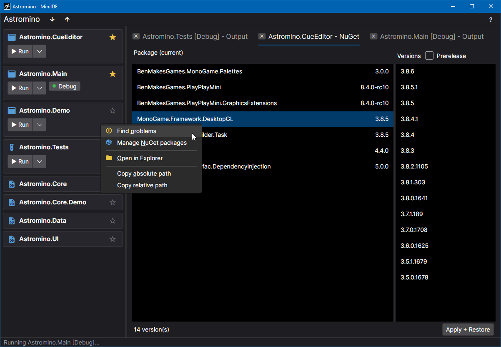

**tl;dr:** this is an experimental C# IDE, intended to be used alongside an external agentic AI that runs in its own thang (such as Claude Code's TUI (flawed though it may be)).

it used to support editing the code - you know, like a normal editor - but the more I use agentic coding tools, the more I find "I don't look at code anymore, let alone write it."

> 🧚 **hey, listen!** [you can support my development of open-source software on Patreon](https://www.patreon.com/BenMakesGames), and/or [check out my game Astromino, on Steam!](https://store.steampowered.com/app/4644350/Astromino/)

### why?

I love Rider - it's been my favorite C# IDE for years - but like all IDEs, it's a resource hog that eats laptop batteries for breakfast, and I get why: Rider & Visual Studio are built to support every use case anyone ever wanted and asked for.

but of all the features Rider offers, I've only used very few; with agentic AIs, I use fewer still. *I barely type code at all anymore!*

(I've tried vscode various times over the years: its UI/UX is simply not to my liking, and their C# support has always lagged, _and_ it's an electron app?! that's extra weight++!)

so, like any ridiculous dev, I've decided to "just" make my own...

### my must-haves

a "dashboard" for managing my solution, and ~~ultimately: to reach a point where I'm comfortable uninstalling Rider.~~ *(I did it :P)*

| feature                               | status                  |
| ------------------------------------- | ----------------------- |
| a decent-ish & modern-ish look & feel | ✅                       |
| per-project warnings & errors view    | ✅                       |
| NuGet package management              | ✔ - could use a UI pass |

### my nice-to-haves

| feature                                               | status                                      |
| ----------------------------------------------------- | ------------------------------------------- |
| syntax highlighting for C#, JSON, XML                 | ✅                                           |
| syntax highlighting for other .NET languages (F#, VB) | ❌                                           |
| nice test result UI (not just console output)         | ❌                                           |
| a way to perform common refactors?                    | ❌ - maybe better for Claude + a Roslyn MCP? |

### my GTFOs

1. custom window chrome
2. scanning the entire solution when the IDE starts up
3. settings so complex they require a built-in search tool and/or giving up & googling

